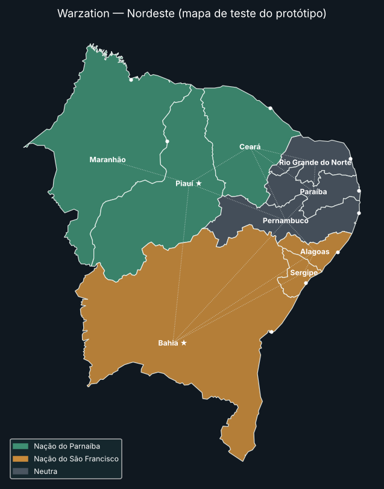

# Dados do jogo

Dados configuráveis que o Backend carrega. Nada aqui contém lógica de regras:
os arquivos descrevem o mundo, e o código decide o que fazer com ele.

## Cenários

Cada cenário fica em `scenarios/<id>/` com dois arquivos:

| Arquivo | Conteúdo |
|---|---|
| `scenario.json` | Províncias, terrenos, depósitos, conexões e nações. |
| `provinces.geojson` | Uma geometria (`Polygon` ou `MultiPolygon`, WGS84, lon/lat) por província, com `properties.id` igual ao `id` da província. |
| `municipalities.json` | Códigos IBGE dos municípios que formam cada província (rastreabilidade; o jogo não precisa ler). |

Valide qualquer mudança com:

```bash
pip install -r tools/mapdata/requirements.txt
python tools/mapdata/validate_scenario.py Backend/data/scenarios/nordeste-teste
```

O CI roda essa validação em todo PR. O Backend também valida os cenários no
startup e não sobe se algum for inválido; a validação geométrica fina
(fronteiras batendo com a geometria) fica só no script Python.

### Formato de `scenario.json` (versão 1)

```jsonc
{
  "formatVersion": 1,
  "id": "nordeste-teste",              // identificador estável do cenário
  "name": "...",
  "provisional": true,                 // valores de balanceamento são provisórios para teste
  "geometryFile": "provinces.geojson",
  "states": [
    { "id": "PI", "name": "Piauí" }    // agrupamento visual; cada estado tem 2 ou 3 províncias
  ],
  "terrains": [
    { "id": "CAATINGA", "name": "Caatinga", "description": "..." }
  ],
  "provinces": [
    {
      "id": "pi-teresina",             // estável: <uf>-<cidade>, minúsculas, sem acento
      "name": "Teresina",              // a província leva o nome da sua cidade principal
      "state": "PI",                   // id de "states"
      "mainCity": { "name": "Teresina", "lon": -42.8019, "lat": -5.0892 },
      "terrain": "CERRADO",            // id de "terrains"
      "coastal": false,                // acesso ao mar, calculado da geometria; NÃO significa que existe Porto
      "deposits": [
        { "resource": "PEDRA", "abundance": "ALTA" }   // PEDRA | METAL | PETROLEO; BAIXA | MEDIA | ALTA
      ]
    }
  ],
  "connections": [["pi-teresina", "pi-floriano"]], // fronteira terrestre; cada par aparece uma vez e vale nos dois sentidos
  "nations": [
    {
      "id": "parnaiba",
      "name": "Nação do Parnaíba",
      "capital": "pi-teresina",
      "startingProvinces": ["pi-teresina", "pi-parnaiba", "pi-floriano"]  // capital + duas províncias contíguas
    }
  ]
}
```

O que **não** entra no cenário, de propósito:

- **construções e estradas:** toda província começa vazia, e o validador rejeita
  esses campos;
- **espaços de construção:** são regra do jogo (3 por província comum, 4 por
  capital), não dado do mapa;
- **unidades, estoques e guarnições neutras:** são estado inicial da partida,
  definidos na issue de posição inicial.

## Cenário `nordeste-teste`

Mapa do protótipo técnico: os 9 estados do Nordeste, **cada um dividido em 2
ou 3 províncias** com o nome de suas principais cidades, 24 no total. Com
estados divididos, a disputa por um estado vira uma sequência de decisões
táticas, e não uma conquista de uma vez só.



A prévia é gerada por `python tools/mapdata/render_preview.py
Backend/data/scenarios/nordeste-teste` (requer `matplotlib`); regenere-a ao
mudar o cenário.

| Estado | Províncias |
|---|---|
| Maranhão | São Luís, Imperatriz, Caxias |
| Piauí | Parnaíba, Teresina, Floriano |
| Ceará | Fortaleza, Sobral, Juazeiro do Norte |
| Rio Grande do Norte | Natal, Mossoró |
| Paraíba | João Pessoa, Campina Grande, Patos |
| Pernambuco | Recife, Caruaru, Petrolina |
| Alagoas | Maceió, Arapiraca |
| Sergipe | Aracaju, Itabaiana |
| Bahia | Salvador, Vitória da Conquista, Barreiras |

### Como as províncias foram desenhadas

As cidades-polo de cada estado estão em `tools/mapdata/nordeste-regions.json`.
Cada **município** do IBGE vai para a cidade-polo mais próxima do mesmo estado
(distância dividida por um peso, que aumenta a região de algumas capitais
litorâneas que ficariam pequenas demais para clicar). Pedaços desconectados
voltam para o vizinho com quem fazem mais fronteira. Assim:

- toda província é contígua;
- todo limite, inclusive o interno de um estado, segue **divisas municipais reais**;
- nenhuma fronteira é inventada.

No Piauí, Floriano entrou como terceiro polo no lugar de Picos. Com Picos, a
região de Teresina contornava Picos pelo sul e ficava com formato de "U".

### Conexões e costa

As 53 conexões e o atributo `coastal` são **calculados da geometria** pelo
gerador. O validador confere que as conexões continuam batendo com as
fronteiras reais, e a menor fronteira compartilhada tem cerca de 30 km, então
nenhuma conexão é só um ponto de contato. O litoral é o contorno externo do
cenário menos as divisas com estados de fora do Nordeste.

### Nações de teste

| Nação | Capital | Províncias iniciais | Perfil |
|---|---|---|---|
| Nação do Parnaíba | Teresina | Teresina, Parnaíba, Floriano (todo o Piauí) | Pedra e metal médios; comida em Parnaíba |
| Nação do São Francisco | Salvador | Salvador, Vitória da Conquista, Barreiras (toda a Bahia) | Metal alto e petróleo; comida em Salvador e pastagem em Vitória da Conquista |

As outras 18 províncias começam neutras. A frente entre as nações é a divisa
Floriano–Barreiras/Salvador, e as capitais ficam distantes. Cada nação tem
saída para o mar por apenas uma província (Parnaíba e Salvador/Vitória da
Conquista).

### Terrenos e depósitos

O terreno é o **predominante, simplificado** para o jogo. Os depósitos partem
de ocorrências reais conhecidas, e o gerador conferiu em que província cada
uma caiu. Exemplos:

- petróleo em Mossoró, Aracaju (Carmópolis), Salvador (Recôncavo) e Maceió (Pilar);
- gesso do Araripe em Petrolina;
- scheelita do Seridó em Natal;
- ferro e níquel de Paulistana em Floriano;
- ferro e urânio de Caetité em Vitória da Conquista;
- gás da Bacia do Parnaíba em Caxias.

A abundância é **provisória para teste** e pode ser ajustada no balanceamento
sem mexer nas fronteiras. O petróleo só tem uso a partir da Era Industrial.

### Geometria: fontes e processamento

- **Municípios:** malha municipal do IBGE em GeoJSON, de
  [tbrugz/geodata-br](https://github.com/tbrugz/geodata-br), licença CC0 (domínio
  público), commit `c39dfb040bfd466fe2a476bafed00749c5c42f16`, arquivos
  `geojson/geojs-21-mun.json` a `geojs-29-mun.json`.
- **Estados vizinhos** (só para separar litoral de divisa): limites estaduais
  da LAGEAMB/UFPR em
  [giuliano-oliveira/geodata-br-states](https://github.com/giuliano-oliveira/geodata-br-states),
  licença MIT, commit `32d7169859c5dad3bd7ae4f2710733b96b02d40f`.
- **Processamento** (`tools/mapdata/build_geometry.py`): agrupamento dos
  municípios, descarte de ilhas menores que 300 km² (Fernando de Noronha e
  Itaparica ficam de fora; a ilha de São Luís continua), simplificação com
  topologia compartilhada (`topojson`, tolerância de 0,02°) e coordenadas com
  4 casas decimais. O erro de área ficou abaixo de 1,2% em todas as províncias.

Para regenerar:

```bash
git clone --depth 1 --filter=blob:none --sparse https://github.com/tbrugz/geodata-br /tmp/mun
git -C /tmp/mun sparse-checkout set --no-cone '/geojson/geojs-2*-mun.json'
git clone --depth 1 https://github.com/giuliano-oliveira/geodata-br-states /tmp/states
python tools/mapdata/build_geometry.py /tmp/mun/geojson /tmp/states/geojson/br_states.json \
  tools/mapdata/nordeste-regions.json Backend/data/scenarios/nordeste-teste
```

O gerador grava `provinces.geojson`, `municipalities.json` e um `derived.json`
com costa e conexões calculadas, que devem ser copiadas para o
`scenario.json`. O `derived.json` é descartável e não fica no repositório.
